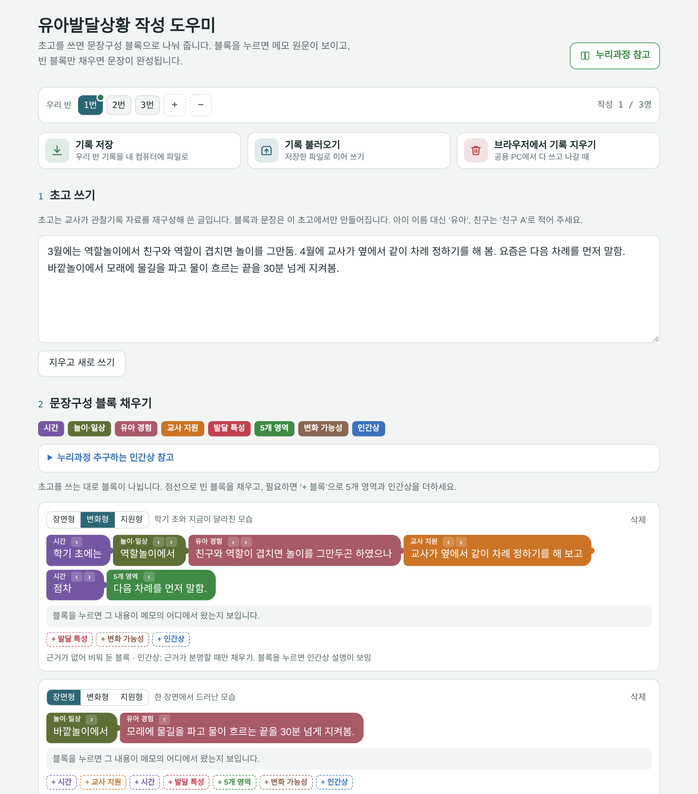

# 유아발달상황 작성 도우미

교사가 관찰기록을 재구성해 쓴 **초고**를 「2026 유치원생활기록부 유아발달상황 작성 현장지원자료」의 기술 요소에 맞춘 **색깔 문장구성 블록**으로 나누어 주는 웹 도구입니다. 교사는 비어 있는 블록만 채우면 되고, 블록을 순서대로 이으면 유아발달상황 문장이 됩니다.

## 사용 방법

1. **우리 반**: 번호로 아이를 고릅니다. `+` 로 아이를 더하고 `−` 로 뺍니다.
2. **초고 쓰기**: 관찰기록을 교사가 재구성해 씁니다. 아이 이름 대신 ‘유아’, 친구는 ‘친구 A’로 적습니다.
3. **문장구성 블록 채우기**: 쓰는 대로 블록이 나뉩니다. 점선으로 된 빈 블록만 채우고, 필요하면 `+ 블록` 으로 5개 영역이나 인간상을 더합니다. 문장 모양은 장면형, 변화형, 지원형 중에서 고릅니다. 지원형은 교사 지원 블록이 유아 경험 앞에 오고, 블록 이름 옆의 ‹ › 로 순서를 직접 옮길 수 있습니다.
4. **완성**: ‘문장 다듬기’를 누르면 초고 말투(~했답니다, ~했음)를 ~함으로 맞추고, 블록 사이에 남은 마침표와 겹친 말을 정리합니다. 마음에 들지 않으면 ‘되돌리기’를 누릅니다. 500자, 명사형 종결(~함.), 쓸 수 없는 부호, 상표명, 평가하는 말을 자동으로 점검한 뒤 문장을 복사해 옮깁니다.

## 8가지 문장구성 블록

시간 · 놀이·일상 · 유아 경험 · 교사 지원 · 발달 특성 · 5개 영역 · 변화 가능성 · 인간상

인간상 블록을 누르면 누리과정이 추구하는 인간상 다섯 가지의 설명이 보이고, 문장 속 낱말을 보고 가까운 인간상을 표시해 줍니다. 인간상은 채워야 하는 칸이 아니라, 관찰이 분명히 보여 줄 때만 문장의 맺음으로 잇습니다.

| 인간상 | 누리과정 설명 |
| --- | --- |
| 건강한 사람 | 자신의 소중함을 알고, 건강하고 안전한 생활 습관을 기르는 |
| 자주적인 사람 | 자신의 일을 스스로 해결하는 기초능력 있는 |
| 창의적인 사람 | 호기심과 탐구심을 가지고 상상력과 창의력을 갖춘 |
| 감성이 풍부한 사람 | 일상에서 아름다움을 느끼고 문화적 감수성을 가진 |
| 더불어 사는 사람 | 사람과 자연을 존중하고 배려하며 소통하는 |

## 개인정보

- 서버가 없습니다. 입력한 내용은 쓰는 사람의 브라우저에만 저장되며 어디로도 전송되지 않습니다.
- AI를 쓰지 않습니다. 블록 나누기는 브라우저 안의 규칙으로 동작합니다.
- 공용 컴퓨터에서는 다 쓴 뒤 ‘지우고 새로 쓰기’로 지워 주세요.

## 알려 둘 점

- 본 프로그램은 유아발달상황 작성에 도움을 드리고자 만들었으며, 교육부와 경기도교육청 공식 자료가 아닙니다.
- 자동 나누기는 낱말 규칙이라 문장에 따라 블록을 잘못 나눌 수 있습니다. 최종 확인은 교사가 합니다.

## 만든 사람

작성: 안은희(시화유치원 원감)
